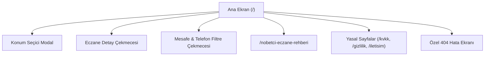
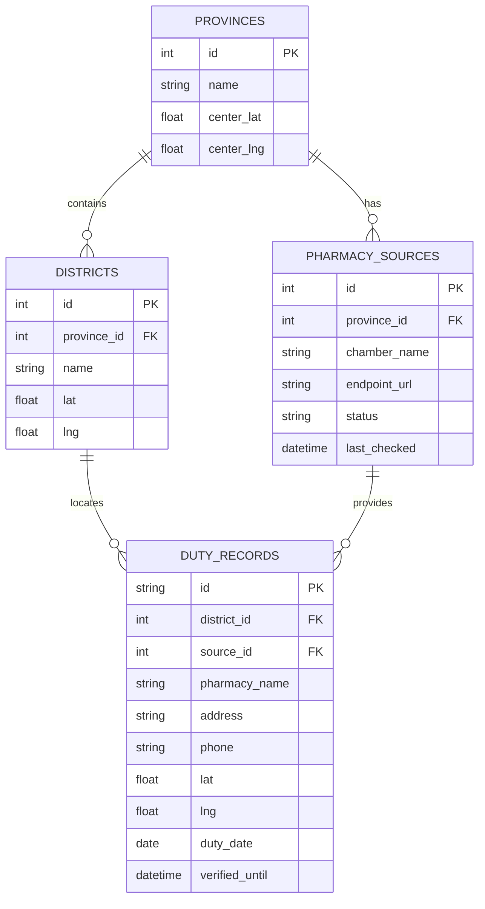

# ŞimdiAcil (Şimdi Açık) — Ürün Dokümanı ve Sistem Mimarisi Şartnamesi (PRD)

**Belge Sürümü:** 1.0.0  
**Tarih:** 13 Ekim 2026  
**Durum:** Onaylandı / Yayına Esas Ürün Belgesi  
**Proje Adı:** ŞimdiAcil (Kod Tabannında: Şimdi Açık)  
**Hedef Alan Adı:** `simdiacik.com` / `simdiacil.com`

---

## 1. Problem Tanımı ve Hedef Kitle

### 1.1 Çözülen Temel Problem
Acil sağlık, ilaç ve reçete ihtiyacı anında (gece yarısı, hafta sonu, bayram ve resmî tatillerde) **zaman en kritik faktördür**. Bir hasta veya hasta yakınının dakikalar içinde açık olan nöbetçi eczaneye ulaşması gerekir.

Mevcut ortamdaki problemler:
1. **Yanıltıcı ve Güncel Olmayan Veriler:** Genel arama motorları ve harita uygulamaları (Google Maps vb.) çoğu zaman olağan çalışma saatlerini gösterir; o gün gerçekten hangi eczanenin nöbetçi olduğunu bilemez.
2. **Reklam ve Spam Tuzakları:** Arama motorlarında "nöbetçi eczane" arandığında çıkan üçüncü taraf haber ve paravan siteler, kullanıcıyı açılır pencerelere (pop-up), yanıltıcı reklamlara ve güncel olmayan listelere boğar.
3. **Kullanışsız Resmî Siteler:** 81 ildeki Eczacı Odalarının resmî web siteleri güvenilirdir; ancak çoğunlukla mobil uyumlu değildir, harita entegrasyonu zayıftır, GPS ile mesafe hesabı yapmaz ve panik anındaki kullanıcıyı karmaşık filtrelerle uğraştırır.

### 1.2 ŞimdiAcil'in Çözümü
ŞimdiAcil, kullanıcının GPS konumuna göre **3 saniye içinde** Türkiye'nin resmî Eczacı Odası verileriyle doğrulanmış, en yakın nöbetçi eczaneleri haritada ve mesafeye göre sıralı listede sunan; tek tıkla arama ve yol tarifi başlatan reklamsız, üyeliksiz, ücretsiz acil sağlık platformudur.

### 1.3 Hedef Kitle (Personalar)
* **Birincil Kitle (Acil İlaç Arayanlar):** Gece yarısı acil servisten çıkan hastalar, ateşi çıkan çocukları için ilaç arayan ebeveynler, ani ağrı ve reçeteli ilaç ihtiyacı olan vatandaşlar.
* **İkincil Kitle (Şehir Dışındakiler & Yolcular):** Bulunduğu ilçeyi ve semti tanımayan seyahat halindeki yolcular, tatilciler ve turistler.
* **Üçüncül Kitle (Sağlık Personeli & Eczacılar):** Nöbeti biten veya hastayı en yakın nöbetçi meslektaşına yönlendirmek isteyen eczacılar, acil servis doktorları ve hemşireler.

---

## 2. Kullanıcı Türleri, Kayıt ve Giriş Süreçleri

### 2.1 Ürün İlkesi: "Zero-Barrier / Zero-Auth" (Kayıtsız ve Engellerden Arındırılmış Acil Erişim)
Acil sağlık anında kullanıcıdan **üye olması, şifre belirlemesi, e-posta veya SMS doğrulama kodu girmesi kesinlikle istenmez**. Bu tür engeller acil durum dönüşümünü ve hastanın ilaca erişimini %90 oranında engeller. Bu nedenle son kullanıcı için **kayıt ve giriş süreci yoktur**.

### 2.2 Kullanıcı Rolleri
| Rol | Erişim Yetkisi | Kimlik Doğrulama | Açıklama |
|---|---|---|---|
| **Son Kullanıcı (Anonim)** | Tam Arama, Harita, Yol Tarifi, Arama | Yok (Sıfır Giriş) | Platforma girdiği anda tüm özelliklerden sınırsız ve ücretsiz yararlanır. |
| **Doğrulayıcı Eczacı (Gelecek Faz)** | Eczane Bilgi Teyidi / Hata Bildirimi | Kurumsal E-posta / SMS OTP | Eczanesinin telefon/adres güncellemesini doğrudan bildiren eczacı profili. |
| **Sistem Yöneticisi (Admin/DevOps)** | Kaynak İzleme, API Sağlığı, Rate Limit | Sunucu Seviyesi / SSH / Dashboard | Harici oda kaynaklarının durumunu ve uptime metriklerini izleyen teknik yönetici. |

---

## 3. Ana Sayfalar, Ekranlar ve Kullanıcı Panelleri



### 3.1 Ana Sayfa & Keşif Ekranı (`/`)
* **Hero & Konumlandırma:** Karşılama başlığı ve "Konumumu Kullan" birincil aksiyon butonu.
* **Sonuç Araç Çubuğu:**
  * Segmented Pill Bar: `2 km`, `5 km`, `10 km`, `20 km` hızlı mesafe butonları.
  * Canlı Arama Kutusu: Eczane adı veya cadde/mahalle adına göre anlık filtreleme (300ms debounce).
  * "Telefonu olanlar" filtre anahtarı (Switch).
* **Liste Görünümü (`.results-list`):**
  * Numaralı eczane kartları (harita pin numarasıyla birebir eşleşir).
  * Canlı nöbet rozeti (`Nöbetçi`), mesafe etiketi (örn: `450 m`, `1.2 km`).
  * "En Yakın" rozeti (mesafesi en kısa olan ilk karta otomatik atanır).
  * Hızlı butonlar: "Yol Tarifi" (birincil yeşil dolgulu) ve "Eczaneyi Ara" (telefonlu kartlar için).
* **İnteraktif Harita (`.map-column`):**
  * Leaflet tabanlı dinamik harita.
  * Seçili konum mavi halkası ve numaralı kırmızı/yeşil eczane pinleri.
  * Kümeleme (clustering) desteği: Birbirine çok yakın eczaneleri sayı rozetiyle toplama.
  * "Bu Bölgede Ara" kayan butonu (harita sürüklendiğinde merkez koordinatı yeniden sorgular).
* **Eczane Detay Çekmecesi (Mobile Sheet / Modal):**
  * Eczane adı, tam adresi, teyitli telefon numarası, resmî nöbet kaynağı atfı.
  * "Adresi Kopyala", "Yol Tarifi Al" ve "Bilgileri Paylaş" butonları.

### 3.2 Nöbetçi Eczane Rehberi (`/nobetci-eczane-rehberi`)
Vatandaşların acil ilaç alırken dikkat etmesi gereken kurallar, nöbetçi eczanelerin çalışma saatleri ve reçete süreçleri hakkında bilgilendirici SEO rehber sayfası.

### 3.3 Yasal ve Bilgilendirme Ekranları
* `/kvkk`: Kişisel verilerin korunması ve sıfır PII saklama taahhüdü.
* `/gizlilik`: Konum izninin yalnızca anlık mesafe için kullanıldığına dair politika.
* `/cerez-politikasi`: Yalnızca tema tercihinin `localStorage`'da tutulduğu, takip çerezi bulunmadığı bilgisi.
* `/kullanim-kosullari`: Hizmetin bilgilendirme amaçlı olduğu, gitmeden önce telefonla teyit gerektiği şartı.
* `/iletisim`: Hata bildirim e-postası (`info@simdiacik.com`).

### 3.4 Özel Hata Ekranları
* **404 Sayfası (`/not-found`):** Kurumsal logolu, marka kimliğiyle uyumlu, doğrudan ana sayfaya yönlendiren CTA içeren sayfa.
* **502 / Kaynak Kesintisi Durumu:** Harici oda sayfasına ulaşılamadığında kullanıcıyı mağdur etmeyen, ilgili Eczacı Odasının resmî web sitesine doğrudan yönlendiren bağlantı.

---

## 4. Kullanıcıların Temel İşlemleri ve Baştan Sona İş Akışları

### Akış A: GPS ile Tek Dokunuşta Yol Tarifi (Hedef Süre: 10 Saniye)
```text
[Kullanıcı Siteye Girer]
       │
       ▼
[“Konumumu Kullan”a Basar] ───(İzin Verildi)───► [Enlem/Boylam Alınır]
       │                                                 │
       ▼                                                 ▼
[İl/İlçe Otomatik Çözülür (/api/location)] ◄─────────────┘
       │
       ▼
[/api/places ile Nöbetçi Eczaneler Çekilir]
       │
       ▼
[En Yakın Eczaneler Listelenir (örn. 350 m)]
       │
       ▼
[Kullanıcı “Yol Tarifi”ne Basar] ──► [Navigasyon Haritası Açılır, Rota Başlar]
```

### Akış B: Manuel İl ve İlçe Seçim Akışı
1. Kullanıcı cihaz konumunu paylaşmak istemediğinde "İl / İlçe Seç" sekmesini tıklar.
2. Türkiye'nin 81 ili arasından ilini (örn: Ankara), ardından ilçesini (örn: Çankaya) seçer.
3. Sistem seçilen ilçenin koordinat merkezine göre ilgili Eczacı Odasının nöbet listesini çeker ve haritada gösterir.

### Akış C: Telefonla Teyit ve Aileyle Paylaşım Akışı
1. Kullanıcı en yakın eczane kartındaki "Eczaneyi Ara" butonuna basar.
2. Telefon arama arayüzü doğrudan açılır (`tel:0312...`).
3. "Paylaş" butonuna bastığında eczane adı, adresi ve harita linki kopyalanır / WhatsApp paylaşım menüsü açılır.

---

## 5. Yönetim Paneli ve Yönetici Yetkileri

### 5.1 Ürün Kararı: "Otomatikleştirilmiş ve Bakım Gerektirmeyen Mimari"
Geleneksel CMS (İçerik Yönetim Paneli) bu ürün için **bilerek tercih edilmemiştir**. Nöbet listelerinin insan eliyle tek tek girilmesi acil durumlarda gecikmelere, hatalı veri girişine ve operasyonel maliyete yol açar. Veri akışı %100 otomatik ve resmî odalardan anlık çekilecek şekilde tasarlanmıştır.

### 5.2 Operasyonel Yönetim ve Sistem İzleme
* **Sağlık Kontrolü Uç Noktası:** `GET /api/health` -> HTTP 200 `{status: 'ok'}`
* **Kaynak Sağlığı İzleme:** İstanbul, Ankara, İzmir, Kayseri, Konya, Samsun, Gaziantep adaptörlerinin anlık hata kodları sunucu konsolunda yapılandırılmış loglarla takip edilir.
* **Hata Bildirimleri:** Kullanıcıların `info@simdiacik.com` adresine gönderdiği yanlış koordinat veya telefon bildirimleri geliştirici ekibin backlog'una düşer.

---

## 6. Ödeme, Üyelik, Abonelik veya Gelir Modeli

### 6.1 Temel İlke: "Halka Açık, Ücretsiz ve Kesintisiz Kamu Hizmeti"
* **Kullanıcı Ücreti:** Sıfır TL. Son kullanıcıdan hiçbir aşamada ücret, bağış, abonelik veya kart bilgisi talep edilmez.
* **Reklam Politikası:** Kullanıcının panik anında yanlış yere tıklamasına yol açabilecek interstitial, pop-up veya dikkat dağıtıcı reklamlar platforma sokulmaz.

### 6.2 Uzun Vadeli Sürdürülebilirlik Seçenekleri
1. **Kurumsal Sosyal Sorumluluk & Sağlık Sponsorluğu:** Büyük sağlık grupları, özel hastaneler veya sağlık sigortası şirketlerinin alt bilgi (footer) alanında "Topluma Destek Sponsoru" olarak yer alması.
2. **Belediye & Açık Veri İş Birlikleri:** Belediyelerin kendi akıllı şehir portallarına entegre edilmesi karşılığında altyapı hibesi.
3. **Acil Ulaşım Entegrasyonları:** Yol tarifi butonunun yanında "Taksi Çağır" (BiTaksi/Uber) gibi acil ulaşım hizmetlerinden komisyonsuz veya bağlı ortaklık modeliyle sürdürülebilirlik sağlanması.

---

## 7. Bildirim, İletişim ve Otomasyon Süreçleri

### 7.1 Otomasyon Süreçleri
1. **60 Saniyelik Akıllı Kenar Önbelleği (Edge Cache):** Aynı bölge için gelen mükerrer sorgular 60 saniye boyunca önbellekten yanıtlanır; Eczacı Odalarının sunucuları aşırı yükten korunur.
2. **Tarih ve Vardiya Sınırı Koruması:** Türkiye saat dilimine göre (`Europe/Istanbul`) gece 00:00 ve sabah 08:30 devir teslim saatlerinde eski günün kayıtları anında geçersiz kılınır ve silinir.
3. **Görünür Sayfa Otomatik Yenilemesi:** Tarayıcı açık kaldığı sürece her 120 saniyede bir liste arka planda sessizce yenilenir (`document.visibilityState === 'visible'`).

### 7.2 Kullanıcı Bildirimleri
* Kullanıcıyı rahatsız eden tarayıcı push bildirimleri kullanılmaz.
* Yalnızca arayüz içi anlık geri bildirimler (Sonner Toasts):
  * *"Adres kopyalandı."*
  * *"İnternet bağlantısı kesildi — Güncel liste için yeniden bağlan."*
  * *"Konum izni verilmedi — İl ve ilçe seçerek devam edebilirsin."*

---

## 8. Veritabanındaki Ana Varlıklar ve İlişkiler

### 8.1 Mevcut Mimari (Stateless & In-Memory Edge Cache)
Sistem şu anda hiçbir ilişkisel veritabanı bağımlılığı olmadan, Cloudflare Worker ve Node.js memory haritası üzerinde çalışmaktadır. Bu sayede 0ms veritabanı gecikmesi, sıfır veri sızıntısı riski ve sıfır hosting maliyeti elde edilir.

### 8.2 Gelecek Faz / Veritabanı Varlık-İlişki Modeli (Drizzle ORM Şeması)
İlerleyen fazda eczane geçmişi ve istatistik tutulmak istendiğinde kullanılacak hazır ER mimarisi:



---

## 9. Kesin Teknoloji Yığını ve Hosting Altyapısı

| Katman | Seçilen Teknoloji | Sürüm | Seçim Gerekçesi |
|---|---|---|---|
| **Kullanıcı Arayüzü** | React | 19.2.6 | Modern Concurrent Rendering, Server Components ve en yüksek render hızı. |
| **Uygulama İskeleti** | Vinext / Vite | 1.0 / 8.0 | Next.js App Router uyumluluğu, Vite motoruyla 300ms derleme hızı, ultra hafif bundle. |
| **Tip Sistemi** | TypeScript | 5.9.3 | Katı tip güvenliği (`strict: true`), sıfır runtime tip hatası. |
| **Stil ve Tasarım** | Tailwind CSS v4 + Vanilla CSS | 4.2.1 | Yeni nesil CSS motoru, özel sağlık tasarım sistemi token'ları, sıfır stil çakışması. |
| **Harita Motoru** | Leaflet + OpenStreetMap | 1.9.4 | Lisans ücreti olmayan, hafif, mobil dostu harita ve kümeleme desteği. |
| **İdari Veri Sağlayıcı** | TurkiyeAPI v2 | v2.0 | Türkiye'nin 81 il ve 973 ilçesini güncel koordinatlarıyla sunan açık kaynak veri seti. |
| **Ters Jeokodlama** | Nominatim (OSM) | v1 | Kullanıcının GPS koordinatından il/ilçe/mahalle tespit eden açık kaynak servis. |
| **Şema ve Doğrulama** | Zod | 3.25.76 | Tüm API girdi parametreleri için katı tip ve sınır doğrulaması. |
| **İkon Seti** | Lucide React | 1.31.0 | Erişilebilir, hafif SVG sağlık ve arayüz ikonları. |
| **Bildirimler** | Sonner | 2.0.8 | Minimalist, modern toast bildirimleri. |
| **Hosting & Çalışma Ortamı** | Railway (Node.js) & Cloudflare | Node 22+ | Global CDN, HTTP/3, otomatik SSL, DDoS koruması ve yüksek erişilebilirlik. |

---

## 10. Özet ve Uygulama Taahhüdü

Bu şartname; **ŞimdiAcil / Şimdi Açık** platformunun tüm ürün vizyonunu, teknik sınırlarını, etik duruşunu ve operasyonel ilkelerini kesinleştirmiştir. 

Sistem; reklam tuzaklarından arındırılmış, kamu yararını önceleyen, kişisel verileri saklamayan ve insan hayatının söz konusu olduğu acil durumlarda en hızlı şekilde doğru ilaca ulaştıran güvenilir bir sağlık altyapısı olarak hizmet vermeye hazırdır.
